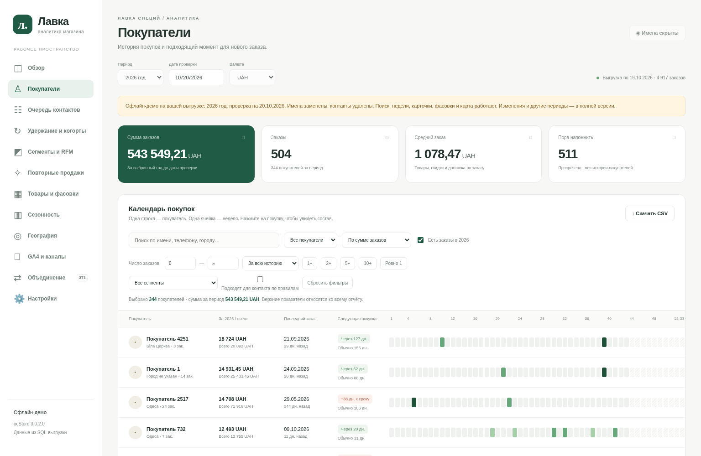

# Лавка — аналитика покупателей, версия 2

Готовое демо и исходники находятся в ветке **analytics-demo**.

## Как открыть демо

1. На этой странице GitHub нажмите зелёную кнопку **Code**.
2. Выберите **Download ZIP**.
3. Распакуйте скачанный архив `test1-analytics-demo.zip` на компьютере.
4. В корне распакованной папки откройте **lavka-demo-v2.html** двойным щелчком в Chrome.

Этот HTML содержит стили, скрипты и данные внутри себя: сервер и установка не нужны.
Чатовый предпросмотр не требуется. Демо предназначено для просмотра, контакты и IP
покупателей удалены. Суммы и состав заказов сохранены.

## Что есть в версии 2

- Календарь по неделям, фильтр числа заказов, 2+/5+/10+.
- Очередь контактов, сегменты и RFM, когорты удержания.
- Повторные покупки, фасовки, товарные пары, ABC и сезонность.
- География адресов и поддержка локальной City MMDB для IP.
- Импорт CSV GA4 и сопоставление транзакций с заказами.

## Полная локальная версия

Исходники — в **spice-analytics/**. Запуск с паролем, настройками, CRM-заметками и
импортом описан в [инструкции](spice-analytics/README.md).
Есть также отдельный комплект **lavka-analytics-v2.zip**.

Демо за 2026 год на 20.10.2026; реальные отчёты GA4 ещё не загружены. Рабочая геобаза
IP пока не установлена. Полная SQL-выгрузка, рабочая БД, контакты и пароли не включены.
